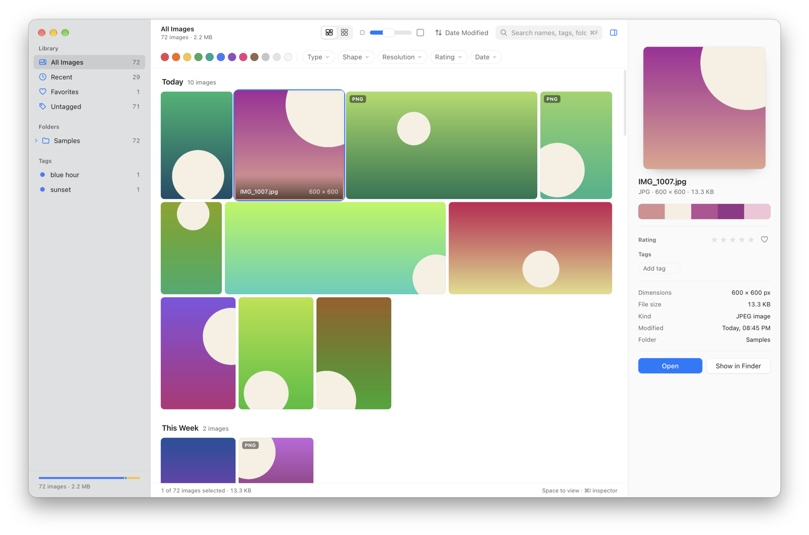

<p align="center">
  
</p>

<h1 align="center">Eagle</h1>

<p align="center">A fast, quiet image viewer for macOS.<br>Add your folders, then browse, filter and look closer, without copying a single file.</p>



## What it does

Eagle indexes folders where they are. Nothing is imported, copied or moved, and new files show up as soon as they land in a folder you've added.

- **Library.** Browse in a justified layout that keeps each image's shape, or in an even grid. Images are grouped by date, and the thumbnail size is adjustable. Large libraries stay smooth because only what's on screen is drawn.
- **Sidebar.** All Images, Recent (modified in the last 30 days), Favorites and Untagged; each folder you've added, with its subfolders; and your tags.
- **Filters.** Filter by colour, file type, shape (landscape, portrait, square, panorama), resolution, rating and date. Search matches file names, captions, authors, tags and folder names as you type. Every image gets a five-colour palette when it's indexed, which is what colour filtering uses.
- **Inspector.** For one image: its caption, palette, rating, favourite, tags and file details. For several: their shared palette, and rating and tagging for all of them at once. With nothing selected: a summary of what's in view.
- **Viewer.** Full-window viewing with fit and 1:1 zoom, pinch to zoom, drag to pan, a filmstrip and an info panel.
- **Captions.** A text file saved next to an image becomes its caption. See [Captions from sidecar files](#captions-from-sidecar-files).
- **AI descriptions and search.** A vision model can describe each image, and search then finds images by what's in them, even in another language. See [AI descriptions and search](#ai-descriptions-and-search).
- **File handling.** Quick Look, Show in Finder, Open with the default app, and Move to Trash with Undo.

Supported formats are JPEG, PNG, GIF, WebP, HEIC, TIFF, BMP, AVIF and camera RAW (ARW, CR2, CR3, NEF, RAF, DNG, ORF, RW2, PEF, SRW). Formats a web view can't show are converted to JPEG previews with macOS's `sips`.

## Captions from sidecar files

An image file holds only pixels, so an image saved from X (Twitter) or another site arrives without the post's text. Eagle reads that text from a sidecar file, a file saved next to the image with the same name, and shows it in the inspector and the viewer's info panel. Search covers it too.

For each image, Eagle uses the first of these it finds:

| Sidecar | What it is |
| --- | --- |
| `photo.jpg.json` | Metadata written by [gallery-dl](https://github.com/mikf/gallery-dl) with `--write-metadata` |
| `photo.json` | The same, saved without the image's extension |
| `photo.jpg.txt` or `photo.txt` | A plain-text note, shown as it is |

For posts from X, Eagle also shows the author (for example "NASA (@nasa)") and a **View on X** button that opens the post in your browser. For other sites gallery-dl supports, it shows the post's text and author and, when the metadata has one, a link to the post. HTML in captions is shown as plain text, and links in a caption can be clicked.

To save posts from X with their text, have gallery-dl write the metadata next to each image. X needs you to be signed in, so pass the cookies from a browser where you are:

```bash
gallery-dl --write-metadata --cookies-from-browser safari -d ~/Pictures/X "https://x.com/USER/status/ID"
```

Replace the address with the post's, and `~/Pictures/X` with a folder you've added to Eagle (gallery-dl saves into subfolders of it, which Eagle sees too). Use `chrome` or `firefox` in place of `safari` for those browsers.

The images appear with their captions as soon as they're downloaded. Sidecars are only read, never changed; edit or delete one and Eagle picks up the change. Files larger than 1 MB are ignored, and captions longer than 5,000 characters are cut.

## AI descriptions and search

Eagle can send each image's thumbnail to [OpenCode Go](https://opencode.ai/docs/go/), where a vision model describes it in a few sentences and a line of keywords. The description shows in the inspector and the viewer's info panel, and clicking a keyword searches for it. Search then matches the words of descriptions, and with **Search by meaning** on it also finds images whose descriptions are close in meaning to what you type, best first: "a person walking alone" finds the lone figure on a path, and 撑伞的人 finds the one with an umbrella though its description is in English.

To set it up, choose **Eagle › Settings…** (⌘,):

| Setting | What it does |
| --- | --- |
| API key | A key of a workspace with OpenCode Go, from the [OpenCode console](https://opencode.ai/console). Eagle keeps it in your Keychain. |
| Model | The Go model that describes images. DeepSeek V4.1 Flash is the default; a model must be turned on for your workspace in the console. |
| Language | What descriptions are written in. |
| Describe every image | Describes the whole library, and new images as they arrive. Off, images are described only when you ask. |
| Search by meaning | Embeds descriptions and captions with Zen's `text-embedding-3-large`, about 2 cents per thousand images. It needs a Zen balance in the same workspace. Off, search matches words only. |

Descriptions always come from Go and count toward its allowance. When the allowance runs out, describing waits until it resets, which Eagle asks Go for, and the sidebar shows when that is; it never moves to Zen, so describing never draws on your Zen balance. Only search by meaning uses Zen.

**Test** describes a small test image with the key and model chosen. To describe images yourself, or describe them again, select them and choose **Describe with AI** (⇧⌘D) from the File menu or their context menu. The sidebar shows how many images are described. When the key or the model is refused, describing pauses until you fix the setting or click **Resume**.

Descriptions are kept in `~/Library/Application Support/Eagle/descriptions.json`, and search vectors in `~/Library/Caches/Eagle/vectors.gob`. A description belongs to a version of a file, so an image is described again after the file changes.

## Keyboard

| Keys | Action |
| --- | --- |
| ⌘O | Add a folder |
| ⌘F | Search |
| ← → ↑ ↓ | Move between images; with ⇧, extend the selection |
| ⌘A | Select all |
| Space or Return | Open in the viewer |
| 1–5 / 0 | Rate / clear the rating |
| F | Favourite |
| ⌘Y | Quick Look |
| ⇧⌘R | Show in Finder |
| ⌘⌫ | Move to Trash |
| ⌘1 / ⌘2 | Justified / grid layout |
| ⌘= / ⌘− | Larger / smaller thumbnails |
| ⇧⌘F | Show or hide the filter bar |
| ⌘I | Show or hide the inspector |
| ⇧⌘D | Describe with AI |
| ⌘, | Settings |

In the viewer: ← → move between images, + − zoom, 0 fits the image to the window, 1 shows it at actual size, I toggles the info panel, and Esc or Space closes it.

⌘-click or ⇧-click a colour swatch to filter by several colours at once.

## Install

Eagle is built from source. It needs macOS, [Go](https://go.dev) 1.27 or later and [Bun](https://bun.sh).

```bash
bun run install:app
```

This builds Eagle for your Mac, installs it in `/Applications` (or `~/Applications` if `/Applications` isn't writable), replacing any copy already there, and opens it. Run it again after pulling changes to update. To install without opening, pass `--no-open` to `scripts/install.sh`; to install somewhere else, set `INSTALL_DIR`. The app is signed ad hoc, which is fine for the Mac that built it; to share it with other Macs, it needs a Developer ID signature and notarization (see `mygo build`).

## Development

Eagle is built with [MyGo](https://github.com/egoist/mygo): a Go backend with a TypeScript and Vite frontend in the system web view.

```bash
bun install
```

```bash
bun run dev
```

`bun run dev` builds the app, starts Vite and rebuilds whenever a file changes. Run it in an interactive terminal, because `mygo dev` stops the app when it has no terminal attached.

```bash
bun run build
```

`bun run build` writes the release app to `build/`.

Other scripts:

- `bun run generate` regenerates `src/mygo.ts`, the typed client for the Go methods, after you change them.
- `bun run typecheck` and `go vet ./...` check the code.
- `go test ./...` runs the Go tests. They talk to a fake OpenCode; `TestLiveOpenCode` talks to the real one when `OPENCODE_API_KEY` and `EAGLE_LIVE_DIR` are set (see `ai_live_test.go`).

### Where things are

| Path | What |
| --- | --- |
| `main.go` | Window, menus and app startup |
| `library.go` | Folders, scanning and watching, indexing, ratings and tags, trash, and the `eagle://` scheme that serves thumbnails and previews |
| `imaging.go` | Dimensions and orientation, thumbnails and previews, palettes and colour families |
| `sidecar.go` | Finding and reading sidecar files: captions, authors and links |
| `ai.go` | AI descriptions and search: the OpenCode client, the queue of images to describe, embeddings and ranking |
| `src/main.ts` | The whole interface: sidebar, grid, filters, inspector and viewer |
| `src/style.css` | Styles, light and dark |
| `src/icons.ts` | Interface icons |
| `src/mygo.ts` | Generated client for the Go methods (don't edit) |
| `resources/icon.png` | App icon |
| `design/` | Icon source: `make-icon.py` writes `icon.svg` |
| `scripts/install.sh` | Builds Eagle and installs it in Applications |

The library (folders, ratings, favourites and tags) is saved in `~/Library/Application Support/Eagle/library.json`. Thumbnails, previews and the index are kept in `~/Library/Caches/Eagle/`. Ratings and tags live in Eagle's library, not in your image files. Development builds use `Eagle Dev` in place of `Eagle` for both folders.
